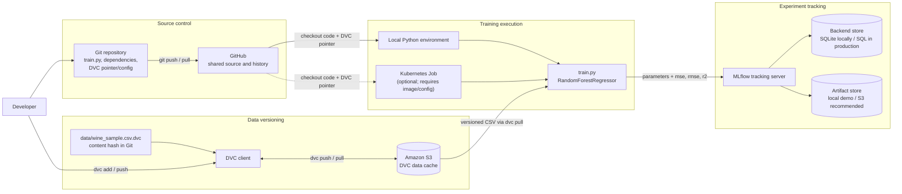
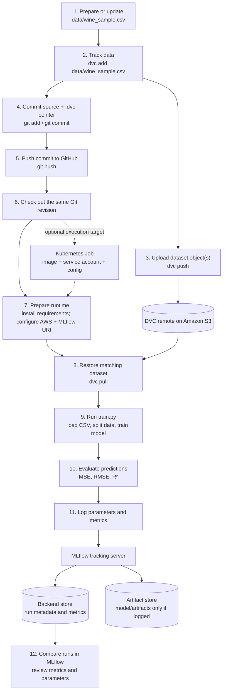

# Wine Quality Prediction (MLOPS PROJECT)

A small regression project that trains a scikit-learn Random Forest, tracks
training parameters and metrics with MLflow, and versions the dataset with DVC.
Git/GitHub stores the source and DVC metadata; Amazon S3 stores the DVC data
cache. Kubernetes is an optional execution environment for repeatable training
jobs.

> **Current scope:** this repository contains `train.py`, `requirements.txt`,
> and a DVC pointer for `data/wine_sample.csv`. It does not yet contain a
> container image, Kubernetes manifests, a deployed MLflow server, or a model
> serving application. Those are infrastructure/deployment steps below, not
> resources created by this repository.

## Architecture



The DVC remote is configured in `.dvc/config` as
`s3://wineprediction-data-store`. The data file itself is excluded from Git;
`data/wine_sample.csv.dvc` records its content hash and size. The training script
uses `MLFLOW_TRACKING_URI`, defaulting to `http://localhost:7006`, and currently
logs run parameters and the `mse`, `rmse`, and `r2` metrics. It does not
currently log a model artifact.

For production, use separate S3 buckets or prefixes for DVC data and MLflow
artifacts, enable S3 versioning and encryption, restrict IAM access, and use a
managed database for MLflow's backend store. Do not commit AWS credentials or
put them in container images, Kubernetes manifests, or GitHub source.

## End-to-end flow

The diagram shows the full path from preparing data through reviewing a tracked
training run. Solid arrows are the normal workflow; the Kubernetes execution
path is optional. GitHub stores code and the small DVC pointer, while S3 stores
the dataset objects addressed by that pointer.



The current `train.py` logs parameters and metrics, but does not log the fitted
model or add the Git revision/DVC hash as MLflow tags. The artifact-store node
shows the MLflow architecture and future use; model artifacts will only appear
there after model logging is implemented.

## Project layout

```text
.
├── data/
│   ├── .gitignore                 # Keeps the raw CSV out of Git
│   ├── wine_sample.csv.dvc        # DVC metadata/pointer committed to Git
│   └── wine_sample.csv            # Materialized by `dvc pull` (not committed)
├── .dvc/
│   └── config                    # DVC S3 remote name and URL
├── train.py                     # Training and MLflow parameter/metric logging
├── requirements.txt
└── readme.md
```

## Installation

Prerequisites:

- Git and Python 3.10 or newer.
- An AWS account and an S3 bucket accessible to your identity for DVC.
- AWS CLI for configuring local AWS access.

Clone the GitHub repository and create an isolated Python environment:

```bash
git clone https://github.com/saudhikmat/wine_quality_prediction.git
cd wine_quality_prediction
python3 -m venv .venv
source .venv/bin/activate
python -m pip install --upgrade pip
pip install -r requirements.txt
```

On Windows PowerShell, activate the environment with
`.venv\Scripts\Activate.ps1`.

Install/configure the AWS CLI if it is not already available. Prefer AWS IAM
Identity Center (SSO) for local development:

```bash
aws configure sso
aws sso login --profile YOUR_PROFILE
export AWS_PROFILE=YOUR_PROFILE
```

In PowerShell, use `$env:AWS_PROFILE = "YOUR_PROFILE"`. For Kubernetes on EKS,
prefer IAM Roles for Service Accounts (IRSA) or EKS Pod Identity over static
access keys.

The DVC remote points at `s3://wineprediction-data-store`; ensure the bucket
exists in the intended AWS account/region and that your identity has the
permissions needed to list, read, and write objects. If using a different
bucket, change the remote URL without adding credentials:

```bash
dvc remote modify winedatasetremote url s3://YOUR_BUCKET/dvc
```

Pull the versioned sample dataset:

```bash
dvc pull
```

If the remote bucket has not yet received the data, `dvc pull` cannot fetch it.
The owner of the source CSV should first place it at `data/wine_sample.csv`,
then run `dvc add data/wine_sample.csv` and `dvc push` (see the workflow below).

## Run training locally

Start a local MLflow tracking server in one terminal:

```bash
mlflow server \
  --host 127.0.0.1 \
  --port 7006 \
  --backend-store-uri sqlite:///mlflow.db \
  --default-artifact-root ./mlartifacts
```

In another terminal, from the repository root and with the virtual environment
activated:

```bash
export MLFLOW_TRACKING_URI=http://localhost:7006
python train.py \
  --csv data/wine_sample.csv \
  --target quality \
  --experiment wine-prediction \
  --run local-baseline \
  --n-estimators 50 \
  --max-depth 5 \
  --test-size 0.3 \
  --random-state 42
```

On PowerShell, set the URI with
`$env:MLFLOW_TRACKING_URI = "http://localhost:7006"`. Open
<http://localhost:7006> to inspect the experiment and its parameters/metrics.
The script's current default test split is `0.9`; the example explicitly uses
`0.3` so the training set is not accidentally reduced to 10% of the data.

## Step-by-step: version data and code with DVC and GitHub

1. **Prepare the dataset.** Keep the CSV at `data/wine_sample.csv`. The target
   column defaults to `quality`; all remaining columns are used as features.
2. **Track the dataset with DVC.** For a new or changed CSV, run:

   ```bash
   dvc add data/wine_sample.csv
   ```

   DVC updates the small `.dvc` pointer and the data directory's ignore rules;
   the actual CSV remains outside Git.
3. **Upload data to S3.** Confirm AWS access and the DVC remote, then run:

   ```bash
   dvc push
   ```

4. **Commit the reproducibility metadata.** Commit the DVC pointer, relevant
   ignore/config changes, and source code:

   ```bash
   git add data/wine_sample.csv.dvc data/.gitignore .dvc/config train.py requirements.txt
   git commit -m "Track wine dataset and training code"
   ```

   Only add `.dvc/config` if its remote URL is safe to share; it should contain
   no credentials. Coordinate changes to the shared remote with the team.
5. **Push the Git commit to GitHub.**

   ```bash
   git push origin main
   ```

   Use the repository's actual branch name if it is not `main`.
6. **Reproduce a run elsewhere.** Clone/pull the Git commit, install
   requirements, configure AWS access, and run `dvc pull`. This checks out the
   dataset content identified by that commit's DVC pointer. Then run training
   with the same arguments and an accessible MLflow tracking URI.
7. **Compare runs in MLflow.** Use the experiment UI to compare logged
   parameters and metrics. Record the Git commit ID and DVC pointer/version
   alongside a run when promoting a model; the current script does not yet log
   these as MLflow tags.

## Kubernetes training workflow

Kubernetes is useful when training should run in a consistent container and
have access to cloud data without depending on a developer's laptop. The
repository currently has no Dockerfile or Kubernetes YAML, so the following is
the deployment sequence rather than a ready-to-apply manifest:

1. **Provision services.** Create the DVC S3 bucket/prefix, an MLflow tracking
   server reachable from the cluster, its backend database, and an artifact
   bucket/prefix. For a production tracking server, keep the database durable
   (for example, managed PostgreSQL) and configure MLflow's artifact store for
   S3. Secure the UI/API behind private networking and authentication.
2. **Build a training image.** Add a Dockerfile that installs
   `requirements.txt` and includes `train.py` plus the DVC metadata/config.
   Publish the image to Amazon ECR. Keep credentials out of the image. Pin
   dependency versions for repeatable production builds.
3. **Grant workload access.** Give the Kubernetes service account least-privilege
   permissions to read the DVC objects and write MLflow artifacts as needed.
   On EKS, use IRSA or EKS Pod Identity; do not put AWS access keys in the Job
   YAML.
4. **Create a Kubernetes Job.** Configure it to use the published image, set
   `MLFLOW_TRACKING_URI` to the cluster-reachable tracking server, and run
   `dvc pull` followed by `python train.py --csv data/wine_sample.csv
   --test-size 0.3`. Supply the Git revision or immutable image tag used for
   the run. Set CPU/memory requests and limits, a retry policy, and a
   completion deadline appropriate to the workload.
5. **Run and inspect.** Apply the Job manifest with `kubectl apply -f
   training-job.yaml`, inspect progress with `kubectl get jobs,pods`, and read
   failures with `kubectl logs job/YOUR_JOB_NAME`. Confirm the completed run in
   the MLflow UI.
6. **Reproduce and promote.** Re-run with a new Git revision/DVC pointer and
   compare the MLflow metrics. Promotion should be a separate, reviewed step;
   this demo does not implement model registration, a serving endpoint, or
   automated deployment.

For CI/CD, GitHub Actions can test changes and build/push an image to ECR.
Use GitHub OIDC federation to assume an AWS role rather than storing long-lived
AWS keys as repository secrets. Trigger training only from an intentional
workflow or deployment process; ordinary source pushes should not implicitly
launch costly jobs.

## Useful commands

```bash
dvc status                 # Check whether tracked data changed
dvc diff                   # Compare DVC-tracked data between revisions
dvc pull                   # Download data for the current Git revision
dvc push                   # Upload data objects referenced by DVC metadata
git status                 # Review source and metadata changes
```

## Troubleshooting

- **`CSV not found`:** run `dvc pull` from the repository root and check the
  `--csv` path.
- **DVC S3 access denied or missing objects:** verify the active AWS identity,
  bucket/prefix, region, and S3 permissions; the remote URL does not provide
  credentials.
- **MLflow connection refused:** start the tracking server and ensure
  `MLFLOW_TRACKING_URI` points to it. In Kubernetes, `localhost` refers to the
  training pod, not the MLflow service.
- **Target column missing:** inspect the CSV header and pass the correct
  `--target` value.
- **Unexpected train/test proportions:** pass `--test-size` explicitly. It is
  a fraction between 0 and 1, and the current script defaults to `0.9`.
